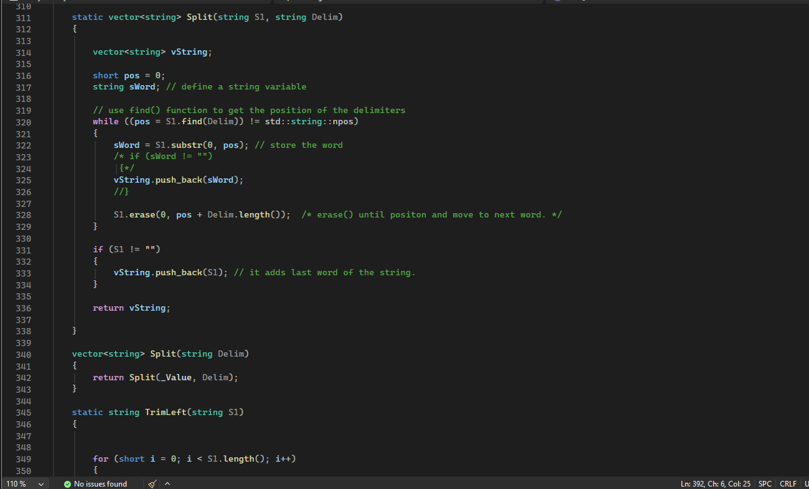
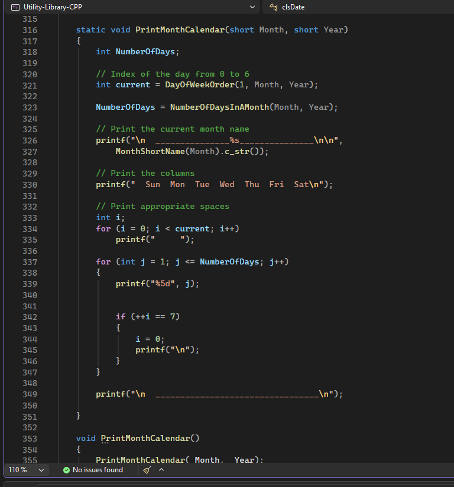
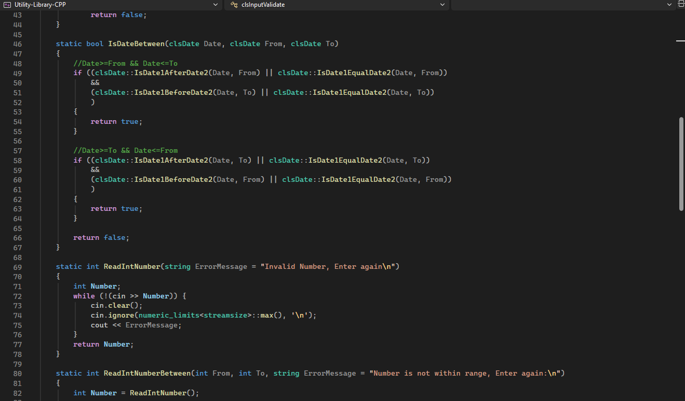
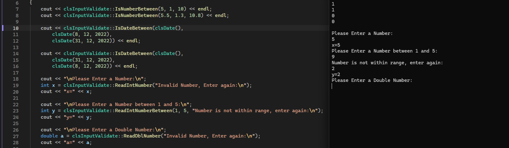

# C++ Utility Library

## Description

My fifth project as a developer and my first project focused on practicing Object-Oriented Programming (OOP) in C++.

A collection of reusable utility classes organized into a header-only library, with a main program demonstrating their usage.

## Features

- **String Utilities (`clsString`):** Perform common string operations, including trimming, splitting, joining, reversing words, changing letter case, counting characters, replacing words, and removing punctuation.
- **Date Utilities (`clsDate`):** Work with dates through validation, formatting, comparison, date arithmetic, calendar generation, and business-day calculations.
- **Input Validation (`clsInputValidate`):** Read and validate integer and double inputs, check whether numbers fall within specified ranges, and validate dates.
- **Reusable Methods:** Use static methods directly through their classes or create objects to work with instance-specific values.
- **Usage Demonstration:** The `main.cpp` file illustrates how to use the provided classes and their methods.

## Screenshots

<!-- Add your screenshots here -->









## Technologies Used

- C++
- Object-Oriented Programming (OOP)
- Standard Template Library (STL)
- Visual Studio

## Concepts Demonstrated

- Classes and Objects
- Encapsulation
- Constructors
- Static and Non-Static Methods
- Function Overloading
- Header Files and Code Organization
- String Manipulation
- Date and Calendar Calculations
- Input Validation
- Vectors (`vector`)
- Pass by Reference
- Reusable Code and Library Design

## Library Structure

The project consists of three main header files:

| Header File | Responsibility |
|---|---|
| `clsString.h` | String manipulation and text-processing utilities. |
| `clsDate.h` | Date handling, validation, comparison, and calculations. |
| `clsInputValidate.h` | Input reading and validation utilities. |

Each class provides reusable functionality that can be included and used in other C++ projects.

## Usage Demonstration

The `main.cpp` file demonstrates how to access the library's functionality.

For example, using the input validation class:

```cpp
cout << clsInputValidate::IsNumberBetween(5, 1, 10);

int x = clsInputValidate::ReadIntNumber();

double y = clsInputValidate::ReadDblNumberBetween(1, 5);

cout << clsInputValidate::IsValideDate(clsDate(35, 12, 2022));
```

The project also demonstrates working with dates and strings through `clsDate` and `clsString`.

## How to Run

1. Clone the repository:

   ```bash
   git clone https://github.com/HeshamSallem510/CPP-Utility-Library.git
   ```

2. Open the solution file in Visual Studio.
3. Build and run the project.
4. Explore the examples in `main.cpp` to see how the utility classes are used.

> The project uses MSVC-specific syntax (`__declspec(property)`) and a Windows console command (`system("pause>0")`), so the current implementation is intended for Visual Studio on Windows.

## Author

**Hesham Sallem**

GitHub: [HeshamSallem510](https://github.com/HeshamSallem510)